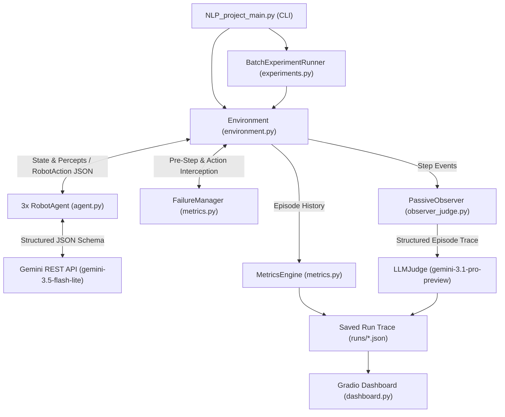

# Multi-Robot Culinary Benchmark — Comprehensive User Guidebook

---

## 1. Executive Summary & System Overview

This framework is a **decentralized, discrete-event multi-agent simulation environment** designed to evaluate **Natural Language Processing (NLP) coordination, grounded reasoning, and failure recovery** across heterogeneous robot teams operating in a shared culinary workspace.

Unlike centralized planners where a single orchestrator dictates every robot's actions, each robot in this benchmark (`Robot_1`, `Robot_2`, `Robot_3`) operates as an **independent LLM-powered agent** (defaulting to Google's **`gemini-3.5-flash-lite`** via the Gemini REST API). At each discrete 1-second simulation timestep, agents must:
1. Perceive their (potentially restricted) view of the kitchen environment.
2. Communicate with teammates using structured natural language messages and speech-act intents (`CommunicationIntent`).
3. Formulate and execute physical actions while respecting **carrying capacities, specialized role skills, tool requirements, workstation occupancy locks, and recipe dependency graphs (DAGs)**.
4. Dynamically detect, communicate, replan, and recover from **controlled runtime perturbations** (7 distinct failure categories).

Post-execution, the framework evaluates episodes through three complementary layers:
- **Deterministic Physical & Communication Metrics (`MetricsEngine`)**: Computes task success, makespan, valid action rates, constraint violations, resource conflicts, dependency errors, per-robot workload shares, failure recovery lifecycles, and natural language grounding/redundancy rates.
- **Independent LLM Judge (`LLMJudge` & `PassiveObserver`)**: Evaluates the full execution and dialogue trace via an independent evaluator model (defaulting to **`gemini-3.1-pro-preview`**) across a **7-dimension semantic rubric (1–5 Likert scale)**, paired with a human-agreement verification harness (`HumanJudgeAgreementVerifier`).
- **Interactive Gradio Telemetry Dashboard (`dashboard.py`)**: Provides a dark-themed analytical interface featuring a 2D kitchen floorplan replay slider, live DAG milestone tracking, inter-robot dialogue inspection, LLM Judge radar charts, and cross-condition statistical matrices.

---

## 2. System Architecture & Module Map

The project is organized into 10 modular Python files at the repository root, alongside prompt documentation, analysis notebooks, and serialized run artifacts:

```text
NLP_project/
├── NLP_project_main.py   # Primary CLI entry point & execution router
├── models.py             # Core enums, data structures, & Pydantic LLM output schemas
├── config.py             # Global simulation constants, recipes, & 5 limitation configs
├── tasks.py              # 6 benchmark tasks, DAG milestone graphs, & TaskVerifier
├── environment.py        # 6-workstation state engine, ActionValidator, & 1s simulation loop
├── agent.py              # RobotAgent cognitive architecture, prompt builder, & Gemini API client
├── metrics.py            # FailureManager (7 perturbations), MetricsEngine, & cost tracker
├── observer_judge.py     # PassiveObserver, 7-dimension LLMJudge, & HumanJudgeAgreementVerifier
├── experiments.py        # 90-run factorial BatchExperimentRunner & StatisticalAnalysisEngine
├── dashboard.py          # Interactive Gradio 6.0 web telemetry & replay dashboard
├── PROMPTS.md            # Complete system prompt templates for RobotAgent and LLMJudge
├── Graphs.ipynb          # Jupyter notebook for generating publication-ready plots
├── requirements.txt      # Python package dependencies
├── .env                  # Local environment variables (GEMINI_API_KEY)
└── runs/                 # Output directory for JSON traces, CSV/JSON summaries, & reports
```

### Data Flow Pipeline


---

## 3. Environment Setup & Configuration

### 3.1 Python & Package Dependencies
Ensure you have **Python 3.10+** installed. Clone or navigate to the project directory and install the required dependencies from `requirements.txt`:

```bash
cd path/to/NLP_project
pip install -r requirements.txt
```

**Core packages (`requirements.txt`):**
- `pydantic>=2.0.0` — Enforces strict JSON schema generation and validation for LLM action/communication outputs (`RobotAction`) and judge evaluations (`JudgeEvaluationSchema`).
- `numpy>=1.24.0` & `scipy>=1.10.0` — Powers descriptive statistics, paired two-tailed $t$-tests, Cohen's $d$, and Pearson correlations in `experiments.py` and `observer_judge.py`.
- `pandas>=2.0.0` & `matplotlib>=3.7.0` — Data manipulation and publication figure generation (`Graphs.ipynb`).
- `gradio>=4.0.0` — Powers the interactive browser-based visualization and replay dashboard.

### 3.2 Configuring the Gemini API Key (`.env`)
The framework communicates with Google's Gemini API (`https://generativelanguage.googleapis.com/v1beta/models/...`) using Python's built-in `urllib.request` client (`GeminiProvider` in `agent.py`), with native `.env` parsing via `load_env()`.

Create or edit the `.env` file in the root directory of the repository:

```env
GEMINI_API_KEY=your_actual_gemini_api_key_here
```

> **Automatic Heuristic Fallback:** If `GEMINI_API_KEY` is missing or if an API call encounters an unrecoverable network error after exponential backoff retries, both `GeminiProvider` (for robot agents) and `LLMJudge` automatically fall back to deterministic, state-aware heuristic engines (`_rule_based_fallback()` in `agent.py` and `_heuristic_evaluation()` in `observer_judge.py`). This ensures that tests, dry runs, and UI debugging never crash due to API quota limits.

---

## 4. Primary CLI Workflows (`NLP_project_main.py`)

All simulation modes, batch experiments, judge agreement tests, and the interactive dashboard are launched through `NLP_project_main.py`.

### 4.1 Supported CLI Arguments

| Argument | Default | Description |
| :--- | :--- | :--- |
| `--task` | `2` | Benchmark task index (`1` to `6`). |
| `--condition` | `reference` | Experimental limitation condition (`1`–`5` or key: `reference`, `capability`, `observation`, `communication`, `combined`). |
| `--failure` | `none` | Inject runtime failure(s) (`none`, `1`–`7`, category name, or comma-separated list like `2,4`). |
| `--seed` | `42` | Random seed for reproducible simulation and failure scheduling. |
| `--timesteps` | `45` | Maximum simulation duration in seconds for a single run. |
| `--model` | `gemini-3.5-flash-lite` | Gemini model identifier for the decentralized robot agents. |
| `--judge-model` | `gemini-3.1-pro-preview` | Gemini model identifier for the independent `LLMJudge` (`none` for heuristic-only). |
| `--verify-judge` | `False` | Run the human vs. LLM Judge agreement verification harness (12 traces, $N=84$ ratings). |
| `--run-experiments` | `False` | Execute the full 90-run factorial experiment matrix ($6 \times 5 \times 3$). |
| `--repetitions` | `3` | Number of repetitions per (Task $\times$ Condition) cell when `--run-experiments` is active. |
| `--dashboard` | `False` | Launch the standalone Gradio dashboard immediately without running a new simulation first. |
| `--no-dashboard` | `False` | Suppress launching the Gradio dashboard after a single simulation run completes. |

### 4.2 Launching the Interactive Dashboard Standalone
To explore existing run traces stored in `runs/` or launch new interactive runs directly from the web UI without running a terminal simulation first:

```bash
python NLP_project_main.py --dashboard
```
This opens the Gradio server at `http://127.0.0.1:7860`.

### 4.3 Running a Single Simulation Episode
Run a single episode from the terminal by specifying the task index (`1`–`6`), limitation condition, optional failure injection, and max timesteps:

```bash
# Run Task 1 (Prepare a salad) under the Reference condition without launching the browser UI
python NLP_project_main.py --task 1 --condition reference --timesteps 26 --no-dashboard

# Run Task 2 (Prepare a burger) under Combined limitations with a Blocked Station (#1) and Missing Tool (#4) failure
python NLP_project_main.py --task 2 --condition combined --failure 1,4 --timesteps 34
```
When a single run completes, the full trace is saved to `runs/run_<task_id>_<condition>.json` and a formatted summary scorecard is printed to the console.

### 4.4 Running the Full 90-Run Factorial Experiment Matrix
To execute the complete benchmark evaluation (**6 Tasks $\times$ 5 Conditions $\times$ 3 Repetitions = 90 episodes**) with paired random seeds and automated statistical analysis:

```bash
python NLP_project_main.py --run-experiments --repetitions 3
```
**What this generates in `runs/`:**
- `runs/exp_t<1-6>_<condition>_rep<1-3>.json`: Individual episode traces for all 90 runs.
- `runs/experiment_results.csv` & `runs/experiment_results.json`: Consolidated flat tables containing 50+ metrics per episode across all 90 runs.
- `runs/statistical_evaluation_report.json`: Complete statistical report containing descriptive statistics ($\text{Mean} \pm \text{SD}$, Median, IQR), paired two-tailed $t$-tests ($t$, $p$, Cohen's $d$) comparing each limitation condition against the `Reference` baseline, and Pearson correlations ($r$, $p$) linking communication behaviors to task outcomes.

### 4.5 Verifying LLM Judge Reliability (Human vs. Judge Agreement)
To run the automated calibration and agreement verification suite comparing `LLMJudge` scores against a 12-trace reference set ($N = 84$ dimension ratings across high-, medium-, and low-quality coordination archetypes):

```bash
python NLP_project_main.py --verify-judge
```
This prints an agreement report (Exact Agreement %, Within-$\pm 1$ Likert Point Agreement %, and Pearson correlation $r$) and exports the results to `runs/human_judge_agreement_report.json`.

---

## 5. Culinary Problem Space & Benchmark Tasks

### 5.1 The 6 Kitchen Workstations (`environment.py` & `config.py`)
The kitchen consists of 6 discrete workstations, each with canonical names, aliases, and 3-letter telemetry codes:

| Code | Canonical Workstation Name | Initial Items & Tools (`config.py`) | Primary Operations Performed Here |
| :---: | :--- | :--- | :--- |
| **`FRG`** | `Refrigerator` | **10 Raw Ingredients:** `tomato`, `lettuce`, `cucumber`, `bread`, `cheese`, `orange`, `meat_patty`, `burger_bun`, `carrot`, `potato` | `PICK` raw ingredients |
| **`CUT`** | `Cutting table` | **Tool:** `knife` | `CUT` (`raw` / `washed` $\rightarrow$ `cut`) |
| **`SNK`** | `Sink` | *(No initial items)* | `WASH` (`raw` $\rightarrow$ `washed`) |
| **`STV`** | `Stove` | **Tools:** `pan`, `pot` | `COOK` (`raw` $\rightarrow$ `cooked`), `BOIL` (`cut` $\rightarrow$ `boiled`) |
| **`ASM`** | `Food assembly table` | **Containers/Tools:** `bowl`, `plate`, `cup` | `ASSEMBLE` (combines prepared ingredients + container into a dish) |
| **`SRV`** | `Serving table` | *(No initial items)* | `DROP` assembled dish (`assembled` $\rightarrow$ `served`) |

### 5.2 Action Space & Physical Preconditions
Agents execute 9 discrete physical actions (`ActionType` in `models.py`), validated at runtime by `ActionValidator` (`environment.py`):

| Action | Duration | Required Station | Physical Preconditions & State Effect |
| :--- | :---: | :--- | :--- |
| **`MOVE`** | `1s` | Any (`target_station`) | Moves robot from current location to `target_station`. |
| **`PICK`** *(alias `MOVE_ITEMS`)* | `1s` | Current station | Item must be at station; robot `len(inventory) < carrying_capacity`. |
| **`DROP`** | `1s` | Current station | Item must be in robot's inventory (or `target_item="all"`). If dropped at `Serving table` and dish state is `assembled`/`ready`, state becomes **`served`**. |
| **`WASH`** | `2s` | `Sink` | Target ingredient must be at `Sink` (or held at `Sink`). Transitions item state to **`washed`**. |
| **`CUT`** | `2s` | `Cutting table` | Requires `knife` at `Cutting table` (or held) + agent compatibility with `knife`. Transitions item state to **`cut`**. |
| **`COOK`** | `2s` | `Stove` | Requires `pan` at `Stove` (or held) + agent compatibility with `pan`. Transitions item state to **`cooked`**. |
| **`BOIL`** | `2s` | `Stove` | Requires `pot` at `Stove` (or held) + agent compatibility with `pot`. Transitions item state to **`boiled`**. |
| **`ASSEMBLE`** | `2s` | `Food assembly table` | All required recipe ingredients (in their exact required states) and the required container (`bowl`, `plate`, or `cup`) must be present at `Food assembly table` (or held by the assembling robot). Consumes ingredients and creates the assembled dish (`state="assembled"`). |
| **`WAIT`** | `1s` | Current station | Robot idles for 1 timestep (used when waiting for a teammate or station lock). |

> **Workstation Exclusivity Locks:** Workstations where an active transformation (`CUT`, `COOK`, `BOIL`, `WASH`, `ASSEMBLE`) is in progress are **locked** to the acting robot until the 2-second operation completes. Concurrent attempts by another robot to use the locked station are rejected and logged as a **Resource Conflict**.

### 5.3 The 6 Benchmark Tasks (`tasks.py`)
The benchmark suite (`TaskBenchmarkSuite`) defines 6 tasks across 3 difficulty tiers (**Easy**, **Medium**, **Hard**), each represented by an explicit Directed Acyclic Graph (DAG) of milestone nodes verified at every timestep by `TaskVerifier`:

| Task # | Task ID & Name | Difficulty | Max Steps (Batch) | DAG Nodes | Target Dish(es) | Required Ingredients & States | Required Container |
| :---: | :--- | :---: | :---: | :---: | :--- | :--- | :--- |
| **1** | `task_1_prepare_a_salad`<br>**Prepare a salad** | **Easy** | `26s` | 7 | `salad` | `tomato` (`cut`), `lettuce` (`washed`), `cucumber` (`cut`) | `bowl` |
| **2** | `task_2_prepare_a_burger`<br>**Prepare a burger** | **Medium** | `34s` | 10 | `hamburger` | `meat_patty` (`cooked`), `burger_bun` (`cut`), `lettuce` (`washed`), `tomato` (`cut`), `cheese` (`cut`) | `plate` |
| **3** | `task_3_prepare_Soup`<br>**Prepare vegetable soup** | **Medium** | `34s` | 10 | `vegetable_soup` | `carrot` (`cut` $\rightarrow$ `boiled`), `potato` (`cut` $\rightarrow$ `boiled`), `tomato` (`cut` $\rightarrow$ `boiled`) | `bowl` |
| **4** | `task_4_sandwich_and_juice`<br>**Prepare a sandwich and a drink** | **Medium** | `34s` | 11 | `sandwich` + `juice` | **Sandwich:** `bread` (`cut`), `cheese` (`cut`), `tomato` (`cut`), `lettuce` (`washed`)<br>**Juice:** `orange` (`washed` $\rightarrow$ `cut`) | `plate` (`sandwich`)<br>`cup` (`juice`) |
| **5** | `task_5_burger_and_salad`<br>**Prepare a burger and a salad** | **Hard** | `44s` | 9 | `hamburger` + `salad` | **Hamburger:** `meat_patty` (`cooked`), `burger_bun` (`cut`), `lettuce` (`washed`), `tomato` (`cut`), `cheese` (`cut`)<br>**Salad:** `tomato` (`cut`), `lettuce` (`washed`), `cucumber` (`cut`) | `plate` (`hamburger`)<br>`bowl` (`salad`) |
| **6** | `task_6_complete_meal`<br>**Prepare a complete meal** | **Hard** | `44s` | 11 | `hamburger` + `vegetable_soup` + `salad` | All ingredients for `hamburger`, `vegetable_soup`, and `salad` (requires duplicate raw items and shared station/container scheduling across all 6 stations) | `plate` (`hamburger`)<br>`bowl` (`vegetable_soup`)<br>`bowl` (`salad`) |

---

## 6. The 5 Experimental Limitation Regimes (`config.py` & `agent.py`)

To isolate how physical, perceptual, and communicative bottlenecks shape multi-agent coordination, the benchmark evaluates every task across **5 limitation conditions** (`LimitationCondition`):

| # | Condition Key | Condition Name | Robot Roles & Capabilities | Carrying Capacity | Observability (`sensor_range`) | Communication Budget (`max_messages_per_step`) |
| :---: | :--- | :--- | :--- | :---: | :--- | :---: |
| **1** | `reference` | **Reference (Unconstrained)** | **Homogeneous Generalists:** All 3 robots possess all skills (`PICK`, `DROP`, `CUT`, `WASH`, `COOK`, `BOIL`, `ASSEMBLE`) and can use all tools. | **3 items** for all robots | **Full Global (`None`):** Sees all 6 stations, all items, and all teammates. | **Unlimited (`None`)** (up to 64 tokens/msg) |
| **2** | `capability` | **Capability-Limited (`setskillset1`)** | **Heterogeneous Specialists:** Asymmetric skills, tool compatibility, and capacities (see Table 6.1 below). | `Robot_1`: **3**<br>`Robot_2`: **1**<br>`Robot_3`: **1** | **Full Global (`None`)** | **Unlimited (`None`)** (up to 64 tokens/msg) |
| **3** | `observation` | **Observation-Limited** | **Homogeneous Generalists** | **3 items** for all robots | **Local Station Only (`sensor_range=1`):** Sees only the robot's current workstation and local items; remote stations are hidden (`UNKNOWN`) unless shared via teammate messages. | **Unlimited (`None`)** (up to 64 tokens/msg) |
| **4** | `communication` | **Communication-Limited** | **Homogeneous Generalists** | **3 items** for all robots | **Full Global (`None`)** | **Restricted (`max_messages=1`/step, max `22` tokens/msg)** |
| **5** | `combined` | **Combined Limitations** | **Heterogeneous Specialists (`setskillset1`)** | `Robot_1`: **3**<br>`Robot_2`: **1**<br>`Robot_3`: **1** | **Local Station Only (`sensor_range=1`)** | **Restricted (`max_messages=1`/step, max `22` tokens/msg)** |

### 6.1 Heterogeneous Specialist Profiles (`setskillset1` in `agent.py`)
When `Capability-Limited` or `Combined` is active, mandatory inter-robot handoffs emerge because no single robot can complete a dish alone:

| Robot ID | Starting Station | Specialist Role | Permitted Skills | Carrying Capacity | Permitted Tools |
| :--- | :--- | :--- | :--- | :---: | :--- |
| **`Robot_1`** | `Refrigerator` | **Carrier** | `PICK` (`MOVE_ITEMS`), `DROP`, `MOVE`, `WAIT` *(Cannot `WASH`, `CUT`, `COOK`, `BOIL`, or `ASSEMBLE`)* | **3 items** | `["all"]` (for transport) |
| **`Robot_2`** | `Cutting table` | **Manipulation** | `CUT`, `WASH`, `ASSEMBLE`, `PICK`, `DROP`, `MOVE`, `WAIT` *(Cannot `COOK` or `BOIL`)* | **1 item** | `["knife", "plate", "bowl", "cup"]` |
| **`Robot_3`** | `Stove` | **Heat-Resistant** | `COOK`, `BOIL`, `PICK`, `DROP`, `MOVE`, `WAIT` *(Cannot `WASH`, `CUT`, or `ASSEMBLE`)* | **1 item** | `["pan", "pot"]` |

---

## 7. Cognitive Agent Architecture (`agent.py`)

Each `RobotAgent` maintains a 4-tier cognitive architecture updated at every simulation timestep:

1. **Perceptual & Teammate World-State Belief Map (`teammate_Change_states`)**:
   - Under global observability, the agent observes the ground-truth state of all 6 workstations.
   - Under partial observability (`Observation-Limited` and `Combined`), remote stations are masked out. However, the agent parses incoming teammate messages (`parse_message_for_beliefs()`) to update its internal belief map of remote stations, teammate locations, and item states.
2. **Episodic Sliding-Window Memory (`memory` & `action_history`)**:
   - Retains recent local perceptions, communication messages, and execution outcomes (including explicit rejection reasons from `ActionValidator` when an action fails).
3. **Structured Speech-Act Communication Protocol (`CommunicationIntent`)**:
   - Every message sent by an agent must declare one of 8 formal speech-act intents (`models.py`):
     - `REQUEST` — Ask a teammate to fetch, prepare, or hand off an item/tool.
     - `OFFER` — Volunteer to perform a sub-task or deliver an item.
     - `REPORT` — Share local observations, completed milestones, or runtime failures.
     - `CONFIRM` — Acknowledge and accept a teammate's proposal or request.
     - `WARN` — Alert teammates to a blocked station, conflict, or missing resource.
     - `REPLAN` — Propose an updated task allocation after a failure or bottleneck.
     - `QUERY` — Ask teammates for the location/state of an unseen item or tool.
     - `IDLE` — Explicit no-message intent when silence is optimal.
4. **Constrained Structured Decoding (`RobotAction`)**:
   - The LLM is queried with `response_mime_type: "application/json"` and a strict `response_schema` matching `RobotAction` (`models.py`), guaranteeing well-formed outputs on every turn:

```json
{
  "function": "CUT",
  "target_station": "Cutting table",
  "target_item": "tomato",
  "recipient": "ALL",
  "intent": "REPORT",
  "message_content": "Cutting tomato at Cutting table; need washed lettuce at Food assembly table."
}
```

---

## 8. Controlled Runtime Perturbations & Recovery Lifecycle (`metrics.py`)

To evaluate resilience and collaborative replanning, `FailureManager` (`metrics.py`) injects **7 controlled runtime failure categories** (`FailureScenarioSuite`):

| Failure # | Category Key | Perturbation Mechanism | Required Team Adaptation |
| :---: | :--- | :--- | :--- |
| **1** | `blocked_station` | Locks a critical workstation (e.g., `Cutting table`) for a fixed duration (e.g., `6s` from $t=4\text{s}$ to $t=10\text{s}$). | Detect block, `WARN` teammates, switch to parallel unblocked sub-tasks (e.g., `WASH` at `Sink` or `COOK` at `Stove`), and resume once unlocked. |
| **2** | `action_execution_failure` | Intercepts an active transformation (`CUT`, `COOK`, `WASH`) so it fails upon completion without transforming the item. | Detect that the item remained in its prior state, `REPORT` the failure, and re-execute the operation. |
| **3** | `delayed_action_completion` | Adds unexpected extra duration (`+3s`) to an in-progress action, extending the workstation lock. | Teammates waiting for the station or output must `WAIT` or reprioritize other milestones rather than colliding. |
| **4** | `missing_item_or_tool` | Temporarily removes or displaces a required tool (e.g., moves `knife` from `Cutting table` to `Sink`). | Discover missing tool, `QUERY`/`REPORT` its location, transport the tool back to `Cutting table`, and resume cutting. |
| **5** | `temporary_agent_drop` | Freezes a specific robot (e.g., `Robot_2`) for `5s`, preventing it from moving or acting. | Active teammates detect `Robot_2`'s unavailability and either take over its pending tasks (if capabilities allow) or stage items for its return. |
| **6** | `corrupted_Delayed_communication` | Drops or corrupts an outgoing inter-robot message at the target timestep. | Agents must detect unacknowledged requests or missing state updates and re-establish synchronization. |
| **7** | `misplaced_item_delivery` | Redirects a `DROP` action so the item lands at an unintended workstation (e.g., `Sink` instead of `Food assembly table`). | Locate the misplaced item, retrieve it via `PICK`, and deliver it to the correct destination. |

### 8.1 Failure Injection Schedule in Batch Experiments
In the 90-run factorial matrix (`BatchExperimentRunner._build_failure_triggers_for_run()` in `experiments.py`):
- **Easy Tasks (Task 1)**: Run perturbation-free (`0` injected failures) to establish clean baseline coordination metrics.
- **Medium Tasks (Tasks 2, 3, 4)**: Deterministically inject **1 runtime failure** per episode (cycled by repetition seed across Blocked Station, Delayed Action Completion, and Misplaced Delivery).
- **Hard Tasks (Tasks 5, 6)**: Deterministically inject **2 compound runtime failures** per episode (combining Blocked Station, Missing Tool, Agent Drop, Action Failure, Delayed Completion, or Misplaced Delivery).

### 8.2 The 5-Stage Failure Recovery Lifecycle
Every injected perturbation is tracked through a 5-stage state machine in `FailureEvent`:
$$\text{Injected} \longrightarrow \text{Detected} \longrightarrow \text{Communicated} \longrightarrow \text{Replanned} \longrightarrow \text{Recovered}$$
- **Recovery Rate**: The fraction of injected failures that reach the `Recovered` state before the episode ends.

---

## 9. Quantitative Metrics & Cost Model (`metrics.py` & `experiments.py`)

At the end of every episode, `MetricsEngine` computes deterministic performance, coordination, communication, and system efficiency metrics:

### 9.1 Task Performance & Coordination Metrics
1. **Task Success Rate (`task_success_rate`)**: Binary indicator (`1.0` or `0.0`) verified by `TaskVerifier` confirming all target dishes are assembled with valid ingredients/containers and `served` on the `Serving table`.
2. **Makespan (`makespan`)**: Total elapsed simulation seconds ($t$) until task completion (or max timestep cutoff).
3. **Valid Action Rate (`valid_action_rate`) & Constraint Violation Rate (`constraint_violation_rate`)**: Proportion of attempted physical actions that satisfied all physical, role, capacity, and station-lock preconditions vs. rejected actions ($\text{ValidRate} + \text{ViolationRate} = 1.0$).
4. **Resource Conflicts (`resource_conflicts`)**: Count of rejected actions caused by attempting to use an occupied/locked workstation or contested tool.
5. **Dependency Errors (`dependency_errors`)**: Count of premature assembly or transformation attempts before upstream recipe prerequisites were satisfied.
6. **Workload Distribution (`workload_distribution`)**: Per-robot completed action counts and percentage shares across `Robot_1`, `Robot_2`, and `Robot_3`.
7. **Total Movements (`total_movements`) & Total Actions (`total_actions`)**: Spatial transitions (`MOVE`) and total physical actions attempted.
8. **Idle Timesteps (`idle_timesteps`)**: Cumulative robot-seconds spent waiting (`WAIT` or no-op).
9. **Replanning Frequency (`replanning_frequency`) & Recovery Rate (`recovery_rate`)**: Number of explicit plan adaptations following perturbations and percentage of injected failures resolved.

*(Note: Legacy fields `dag_progress_pct` and `workload_gini` are retained in the JSON/CSV schema for backward compatibility but omitted from primary dashboard scorecards.)*

### 9.2 Natural-Language Communication Metrics
- **Message & Token Volume**: `number_of_messages`, `total_communication_tokens`, `average_message_length_tokens`.
- **Communication Efficiency**: `messages_per_successful_task` and `tokens_per_successful_task`.
- **Grounded Message Rate (`grounded_message_rate`)**: Fraction of messages whose referenced items, tools, and workstations accurately match the physical environment state at the time of transmission.
- **Redundant Message Rate (`redundant_message_rate`)**: Fraction of messages that repeat identical intent and content within a 3-step window without an intervening environment state change.
- **Speech-Act Distribution (`communication_function_distribution`)**: Percentage breakdown across `REQUEST`, `OFFER`, `REPORT`, `CONFIRM`, `WARN`, `REPLAN`, and `QUERY`.

### 9.3 API Latency, Token Usage & Cost Estimation
`GeminiProvider` records wall-clock latency (`ms`), prompt tokens, and completion tokens for every LLM call, estimating monetary cost using standard Gemini Flash-Lite pricing (`$0.075` per 1M input tokens, `$0.30` per 1M output tokens).

---

## 10. Independent LLM Judge & Human Agreement (`observer_judge.py`)

Because surface token counts cannot capture whether dialogue genuinely helped the team coordinate, `PassiveObserver` records a structured chronological transcript of every episode and passes it to `LLMJudge` (`gemini-3.1-pro-preview`).

### 10.1 The 7-Dimension Semantic Rubric (1–5 Likert Scale)
1. **Relevance (`1–5`)**: Alignment of messages with active task goals and immediate recipe bottlenecks.
2. **Clarity (`1–5`)**: Unambiguous specification of target items, stations, and action responsibilities.
3. **Grounding (`1–5`)**: Factual consistency of claims with actual workstation contents, tool locations, and robot capabilities (absence of hallucinations).
4. **Coordination Utility (`1–5`)**: Degree to which communication prevents conflicts, enables handoffs, and advances the task DAG.
5. **Redundancy (`1–5`)**: Conciseness and absence of repetitive chatter *(reverse-coded so `5 = minimal redundancy / highly concise`, `1 = severe spam`)*.
6. **Planning Coherence (`1–5`)**: Logical sequencing of multi-step dependencies across the robot team.
7. **Failure Explanation Quality (`1–5`)**: Accuracy and actionability of diagnostic communication when runtime failures occur.

- **Overall Judge Score (`overall_score`)**: Mean across all 7 rubric dimensions (`1.00` to `5.00`), accompanied by qualitative `strengths`, `weaknesses`, `key_observations`, and `summary_rationale`.

---

## 11. Navigating the Interactive Gradio Dashboard (`dashboard.py`)

Launch the dashboard via `python NLP_project_main.py --dashboard` and open `http://127.0.0.1:7860` in your browser. The interface is organized into **3 main tabs**:

### Tab 1: Simulation Replay & Live Execution
- **Sidebar Controls**:
  - **Load Saved Run (`runs/*.json`)**: Select any of the 90 batch experiment traces (e.g., `exp_t1_reference_rep1.json`) or custom runs and click **Load Selected Trace**.
  - **Launch New Simulation**: Pick a Task (`1`–`6`), Limitation Condition (`1`–`5`), Failure Scenario (`none` or `1`–`7`), and Max Timesteps, then click **Run Simulation** to execute and visualize a fresh episode live.
- **Interactive Timestep Scrubber**: Drag the **Timestep (`t`) slider** or use the step buttons (`t = 0` to `t = T`) to inspect the exact state of the kitchen at any second:
  - **2D Kitchen Floorplan SVG**: Displays all 6 workstations (`FRG`, `CUT`, `SNK`, `STV`, `ASM`, `SRV`), workstation lock indicators, item state badges (`raw`, `washed`, `cut`, `cooked`, `boiled`, `assembled`, `served`), and robot avatars with their held inventories and active operations.
  - **Task Dependency Graph (DAG) Panel**: Color-codes every recipe milestone node in real time (**Green** = completed, **Blue** = ready/actionable, **Slate** = waiting on upstream dependencies) so you can see exactly where bottlenecks occur.
  - **Inter-Robot Communication Feed & Per-Step Event Log**: Shows messages sent at timestep `t` (with speech-act badges) alongside cumulative dialogue history and validator rejection logs.
- **Episode Scorecards**: Displays Task Performance & Coordination metrics, Natural-Language Communication metrics, and the 7-dimension **LLM Judge Radar SVG Chart** & qualitative critique.

### Tab 2: 90-Run Statistical Suite & Condition Comparison
- Automatically loads `runs/statistical_evaluation_report.json` and `runs/experiment_results.csv`.
- **Cross-Condition Summary Matrix**: Compares `Reference`, `Capability-Limited`, `Observation-Limited`, `Communication-Limited`, and `Combined` across Success Rate, Makespan, Valid Action Rate, Conflicts, Messages, Grounding Rate, and LLM Judge Score ($\text{Mean} \pm \text{SD}$ and $\text{Median [IQR]}$).
- **Hypothesis Testing Table**: Displays paired two-tailed $t$-statistics, $p$-values, and Cohen's $d$ effect sizes against the `Reference` baseline.
- **Communication-to-Outcome Correlation Table**: Displays Pearson $r$ and $p$-values linking message volume, grounding rate, redundancy, and judge utility to task success and makespan.

### Tab 3: Human vs. LLM Judge Calibration
- Loads `runs/human_judge_agreement_report.json` (or lets you trigger a fresh verification run on the 12-trace benchmark set) and displays per-dimension Exact Agreement %, Within-$\pm 1$ Agreement %, and Pearson $r$.


